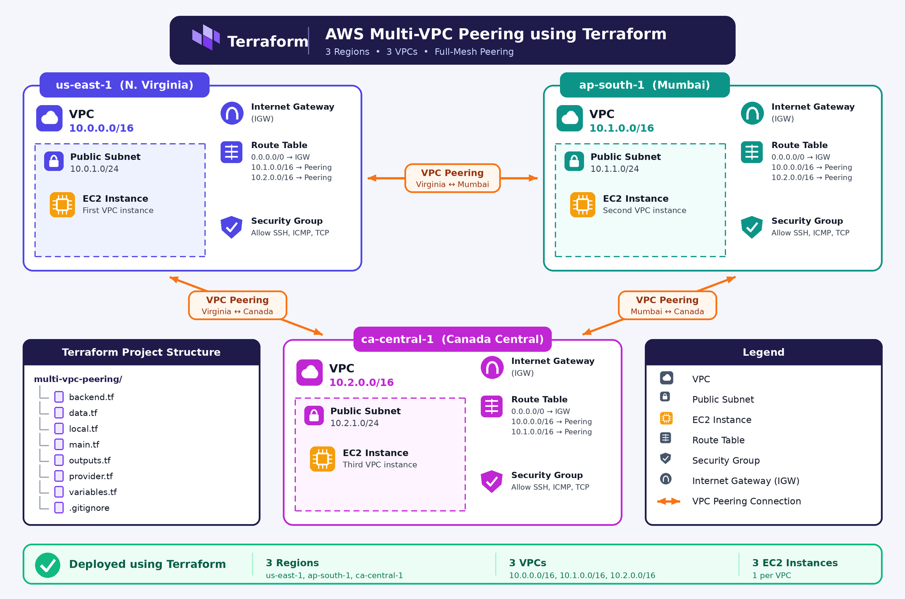

# AWS Multi-VPC Peering Architecture Using Terraform

## 1. Project Overview

This project focuses on designing and deploying a multi-VPC
network architecture on AWS using Terraform.

Multiple Virtual Private Clouds (VPCs) are created to represent
different environments. VPC Peering connections allow these
networks to communicate privately using AWS networking services.

Terraform is used to provision and manage the infrastructure
through Infrastructure as Code (IaC).

The project demonstrates how to build a structured AWS network
with controlled communication between separate VPCs.

---

## 2. Project Objectives

The main objectives of this project are:

- Create multiple VPCs using Terraform.
- Configure separate CIDR blocks for each VPC.
- Establish VPC Peering connections between VPCs.
- Configure route tables for communication between networks.
- Apply security group rules to control network traffic.
- Deploy EC2 instances for connectivity testing.
- Verify private communication between instances.
- Practice Infrastructure as Code using Terraform.
- Organize AWS infrastructure configuration into reusable files.

---

## 3. Architecture Overview

The architecture contains three VPCs representing different
environments.

### Network Design

| VPC Name | Environment | CIDR Block |
|----------|-------------|------------|
| Development VPC | Development | 10.0.0.0/16 |
| Testing VPC | Testing | 10.1.0.0/16 |
| Production VPC | Production | 10.2.0.0/16 |

### Peering Design

The following connections are configured:

- Development VPC ↔ Testing VPC
- Testing VPC ↔ Production VPC
- Development VPC ↔ Production VPC

Each peering connection provides a private network path between
the two VPCs involved.

Note: VPC Peering does not support transitive routing. Each
required communication path must have its own peering connection
and appropriate route table entries.

---

## 4. AWS Services Used

### Amazon VPC
Provides isolated virtual networks for different environments.

### VPC Peering
Connects two VPCs so that resources can communicate using
private IP addresses.

### Route Tables
Define where network traffic is directed, including traffic
destined for peered VPC CIDR blocks.

### Security Groups
Act as virtual firewalls for EC2 instances and control
permitted inbound and outbound traffic.

### Amazon EC2
Provides virtual servers that can be used to test connectivity
between VPCs.

### Amazon S3
Stores the Terraform state remotely when an S3 backend is configured.

### AWS IAM
Controls permissions for the identity used by Terraform to
create and manage AWS resources.

---

## 5. Terraform Implementation

Terraform is used to define and provision AWS infrastructure
through configuration files.

The project separates provider configuration, variables,
network resources, outputs, and backend settings into individual
files for better organization.

### Terraform Workflow

1. Define the required AWS provider.
2. Configure input variables and CIDR blocks.
3. Define VPC resources and peering connections.
4. Configure route tables and security groups.
5. Initialize the Terraform working directory.
6. Validate the Terraform configuration.
7. Review the execution plan.
8. Apply the approved infrastructure changes.
9. Verify the deployed resources in AWS.

### Terraform Commands

Initialize Terraform:

    terraform init

Format the configuration:

    terraform fmt -recursive

Validate the configuration:

    terraform validate

Review planned changes:

    terraform plan

Deploy the infrastructure after reviewing the plan:

    terraform apply

---

## 6. Network Configuration

Each VPC uses a unique IPv4 CIDR block to avoid overlapping
IP address ranges.

| Network | CIDR Block |
|---------|------------|
| Development | 10.0.0.0/16 |
| Testing | 10.1.0.0/16 |
| Production | 10.2.0.0/16 |

Using separate address ranges helps maintain clear network
boundaries and simplifies routing between environments.

The VPCs are connected through explicitly configured peering
connections rather than through transitive routing.

---

## 7. VPC Peering Configuration

VPC Peering connections establish private connectivity between
the selected VPC pairs.

The project configures these connections:

1. Development to Testing
2. Testing to Production
3. Development to Production

The peering connections are configured through Terraform.

After a peering connection is active, appropriate routes must
be configured in both participating VPCs.

Peering alone does not automatically configure all required
routes or security permissions.

---

## 8. Route Table Configuration

Route tables determine how traffic travels between the VPCs.

Each VPC route table includes routes for the CIDR blocks of
the other VPCs that it must communicate with.

### Development VPC
- Route to the Testing VPC CIDR through the Development–Testing
  peering connection.
- Route to the Production VPC CIDR through the
  Development–Production peering connection.

### Testing VPC
- Route to the Development VPC CIDR through the
  Development–Testing peering connection.
- Route to the Production VPC CIDR through the
  Testing–Production peering connection.

### Production VPC
- Route to the Development VPC CIDR through the
  Development–Production peering connection.
- Route to the Testing VPC CIDR through the
  Testing–Production peering connection.

These routes provide the network paths required for
communication between the configured VPC pairs.

---

## 9. Security Group Configuration

Security groups control traffic entering and leaving the
associated EC2 instances.

Security rules should follow the principle of least privilege.

The configuration should allow only the required traffic
between the intended resources.

For example:

- Allow ICMP traffic from an approved peer VPC CIDR when
  testing connectivity with ping.
- Allow SSH on TCP port 22 only from a trusted administrative
  IP address or approved management network.
- Avoid opening administrative ports to all IPv4 addresses.

Security group rules must be configured consistently with
the intended connectivity tests.

---

## 10. EC2 Instance Deployment

EC2 instances can be deployed in the participating VPCs to
verify private network connectivity.

For a practical demonstration, instances can be placed in
appropriate subnets in the Development and Testing VPCs.

Each instance should have:

- A private IP address.
- An appropriate subnet and route table.
- A security group allowing the required test traffic.
- A suitable method for administrative access.

Public IP addresses are not required for communication between
peered VPCs when private routing is configured correctly.

---

## 11. Connectivity Testing

Connectivity testing verifies whether the network configuration
works as expected.

### Test 1: Verify VPC Peering

Confirm that each required peering connection is active.

### Test 2: Check Route Tables

Verify that the correct peer CIDR blocks point to their
corresponding peering connection IDs.

### Test 3: Verify Security Groups

Confirm that the security groups permit the required test traffic.

### Test 4: Test Private Connectivity

From an authorized source instance, test connectivity to the
private IP address of an instance in the peered VPC.

For example:

    ping <destination-private-ip>

Ping succeeds only if the instances, routes, and security
rules permit ICMP traffic and the operating systems allow it.

A failed ping does not necessarily mean the peering connection
is broken; routing, firewall rules, and instance configuration
should also be checked.

Record the actual test results after deploying the infrastructure.

---

## 12. Challenges and Learnings

This project provides practical experience with:

- Designing a multi-VPC network.
- Understanding VPC Peering and its limitations.
- Configuring routes for private communication.
- Managing AWS infrastructure through Terraform.
- Using input variables, local values, and outputs.
- Understanding the relationship between routing and security groups.
- Troubleshooting connectivity between separate VPCs.
- Managing Terraform state and infrastructure changes safely.

---

## 13. Conclusion

This project demonstrates how Terraform can be used to define
and manage a multi-VPC networking environment on AWS.

It combines VPC creation, peering connections, route tables,
security group configuration, and EC2-based connectivity testing
into a structured Infrastructure as Code project.

The implementation provides practical experience with AWS
networking concepts and Terraform-based infrastructure management.

---

## Author

Sakshi Somvanshi

AWS Cloud | Terraform | Infrastructure as Code 

## Architecture Diagram

## Project Documentation
[📄 View Project PDF](https://github.com/sakshi-somvanshi/multi-vpc-peering-terraform/blob/master/AWS_Multi-VPC_Peering_Sakshi_Somvanshi%20(1).pdf)
